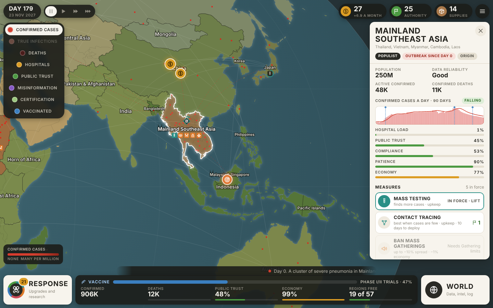

# Containment

A pandemic response strategy game in the spirit of *Plague Inc.* and *Rebel
Inc.*, played from the other side. A new pathogen has been confirmed in one
region of the world, and you run the global response: find it, slow it, treat
it and vaccinate against it before it outruns you. The pathogen adapts to
whatever you do.



Like [Frontline 1944](../frontline-1944/), the whole game is one
self-contained file, `index.html`. It needs no assets, no dependencies, no build
step and no network. The map is embedded vector data, everything is drawn on a
canvas, and the music and sound effects are synthesised at runtime.

## Play

Open `index.html` in any modern browser, on a laptop or a phone. Progress and
the current game are saved in the browser's local storage. Click or tap once to
enable sound.

## How it plays

- **You see confirmed cases, not real ones.** Each region reports only what its
  surveillance catches, so poor, crowded regions look clean long after they are
  burning. Detection upgrades narrow the gap. *Epidemic modelling* adds each region's
  estimated true infections and reproduction number to its panel, and the end
  screen shows what was really there.
- **Funding** comes from donors (less when the economy or trust is weak) and
  from gold bubbles on the map (blue ones, until a vaccine is approved, are
  research breakthroughs). It pays for 73 upgrades across five hex trees:
  Detect, Contain, Treat, Vaccine and Society. Each shows, in numbers, what it
  would change today (cases found, transmission, fatality, beds, research speed
  and so on). Prices rise as you buy, so you cannot have everything.
- **Authority** is political capital. You spend it to impose 18 kinds of
  measure region by region: testing, contact tracing, gathering bans, masks,
  distancing, school closures, lockdowns, cordons, border, port and flight
  closures, arrival quarantine, field hospitals, shielding, sick pay,
  vaccination drives, and vector control or safe burials where the pathogen
  calls for them. Measures cost economy and patience every day they stay in
  force. Tired publics comply less, and a region whose trust collapses defies
  you outright.
- **Nothing happens at once.** As in Rebel Inc, a measure takes days to deploy
  (a flight ban one, a lockdown three, field hospitals fourteen) and its effect
  builds as it does; the region's panel shows how far along it is. A funded
  upgrade rolls out over one to three weeks, and anything that needs it waits
  until it is in force. Response → Progress lists what is rolling out and what
  each programme changed when it landed. Each region's panel charts its daily cases with a mark where
  each measure began, so you can see whether it bent the curve.
- **Field teams** are units you move around the map: epidemiology, medical,
  vaccination and community teams. Each travels to the region you send it to,
  sets up, then works there (finding hidden cases, adding beds, speeding up
  doses, raising trust) until you move it.
- **Misinformation is a second front.** Rumours start where people are tired,
  frightened and distrustful, then spread to neighbouring regions and along
  flight routes. Each region's panel shows how far they have spread. Where they take hold, people
  comply less, refuse the vaccine and lose trust. Fact-check campaigns,
  community teams and crackdowns (fast, but they cost trust) push them back.
- **Every region has a government**: cooperative, sceptical, authoritarian or
  populist, each changing how measures land. Democracies hold elections, and
  tired, poorer, misinformed publics vote in populists who lift the harshest
  restrictions on day one.
- **Flashpoints** (rare: about one a year) put a clock on the map: a pilgrimage, a cruise ship, an
  outbreak in a camp or a prison, a mass rally. You get about three weeks,
  and time drops to normal speed when one appears. Meet one of its needs in
  time (a measure fully in force, the right team on the ground, or the money)
  and it passes quietly. If time runs out, the game stops and asks: pay now,
  hold on a few more days if help is about to arrive, or let it go ahead.
- **Money has to last.** Paid programmes and deployed teams cost upkeep every
  day, so the HUD shows your Funding net of it. **Medical supplies** build up
  slowly; field hospitals, medical teams and supply drops use them.
- **The vaccine** needs the genome (*Genome sequencing*) before research really
  starts. Research runs in wealthy regions' labs, so wrecking their economies
  slows it. Once approved, rollout is limited by factories, by each region's
  cold chain, by vaccine hesitancy, and by rich regions buying first unless you
  fund equitable allocation. From phase III trials, ring vaccination stamps
  out small clusters.
- **The pathogen fights back, and you can see it coming.** It earns evolution
  from the number of people infected and spends it on traits that counter your
  strategy: silent carriage if you lean on testing, transmissibility if you lean
  on restrictions, immune escape once you vaccinate. With genomic surveillance,
  World → Intelligence shows what it is likely to evolve next and why, and you
  are told where a new lineage is emerging; an epidemiology team, a cordon or
  case finding there can stamp it out before it spreads.
- **Decisions** interrupt the game every month or so: mass gatherings,
  whistleblowers, protests, export bans, challenge trials and elections, each
  with a real trade-off.
- **Regions are certified free** after 42 days without a confirmed case (28
  with active surveillance there). Hidden chains can break certification, so
  the endgame is a mop-up race, region by region.
- **You win** when the pathogen is gone and every region that had cases has
  gone a fortnight clean, or when no case has been confirmed anywhere for six
  weeks and every region is clear. If an animal reservoir has appeared, One
  Health surveillance is also needed, and the HUD says so when it is all that
  is left. **You lose** if the death toll passes what the world
  can absorb, if global trust falls to 14%, or if the pathogen is still
  circulating when time runs out. The end screen grades detection,
  containment, treatment, the vaccine, trust and the economy, and marks the
  turning points.

## Pathogens and difficulty

Six pathogens, each with a rule of its own. A chip under the clock shows its
signature as it plays out, and each marks the map differently:

- **Novel Coronavirus**: silent spread. About a third of cases show no
  symptoms, so testing, tracing and wastewater matter most.
- **Pandemic Influenza**: winter waves, hemisphere by hemisphere, and a strain
  that drifts away from the vaccine every year unless an mRNA platform or
  boosters ship an update. Washes the map orange-red.
- **Mosquito-borne Fever**: only mosquitoes carry it. The map hatches today's
  mosquito habitat, which moves with the seasons; vector control works,
  lockdowns barely do.
- **Superbug**: spreads on crowded hospital wards, so beds, field hospitals and
  medical teams slow it as well as saving lives. Antibiotics work until it
  learns to resist them.
- **Haemorrhagic Fever**: lethal, spread by contact, and every unsafe funeral
  seeds new cases until safe burials stop them. Deaths frighten publics more.
- **Disease X**: randomised, its profile hidden until you sequence and model it.

The first two are open from the start; beating one unlocks the next.

**Recruit**, **Regular**, **Hardened** and **Brutal** change funding,
Authority, research speed, how fast and how cleverly the pathogen evolves, how
much has spread silently before day one, how quickly publics lose patience and
believe rumours, how often flashpoints flare, upkeep, and how many deaths the
world can absorb. A **short game** gives you two and a half years instead of
four, with faster labs and rollouts. A win earns one to three stars depending
on the death toll.

## Ways to play

- **Outbreak**: pick a pathogen, a difficulty and a length, then an origin.
- **Scenarios**: six set pieces with their own objectives. *First response* is
  a guided first game that walks you through the response step by step; *Hold
  the line* asks you to keep it inside Asia; *The great influenza* asks you to
  survive two years; others start in West Africa with rumours already loose,
  with a superbug that already resists antibiotics, or blind against Disease X.
- **Daily**: the same outbreak, origin and two rule-changing modifiers for
  everyone on a given day (no lockdowns, busy skies, tight budgets, an
  infodemic and so on).

## Look

The design follows Rebel Inc. A muted, earthy world map carries the game; over
it float small dark controls (the clock and the money), and when
you open something it arrives as a light paper card with dark ink, rounded
corners and a soft shadow. Colour is used sparingly and always means the same
thing: **red** is the pathogen, **green** is stability (trust, Authority,
certification), **gold** is money, **blue** is the vaccine, **violet** is
misinformation and **tan** is medical supplies. The five Response areas each
have their own colour on their tab, their upgrades and the measures they
unlock: Detect teal, Contain orange, Treat coral, Vaccine blue, Society green.
The tokens live at the top of the `<style>` block and in the `PAL` and `CAT`
objects in the UI script.

## Controls

| Action | Mouse / keyboard | Touch |
| --- | --- | --- |
| Pan / zoom | Drag, scroll wheel, `+` `-` | Drag, pinch |
| Open a region | Click it | Tap it |
| Collect a bubble | Click it | Tap it |
| See a flashpoint's needs | Click its marker | Tap its marker |
| Pause / speed | `Space`, `1` `2` `3` | Buttons, top left |
| Response / World | `R` / `W` | Buttons, bottom |
| Close a panel | `Esc` | ✕ |

In the menu, **Pause on alerts** stops the clock for flashpoints, emerging lineages, new variants and lost certifications.

## Code

`index.html` holds four blocks:

- `<style>` and the markup.
- `<script id="mapdata">`: 57 playable regions merged from Natural Earth
  1:50m countries (public domain), projected and simplified into SVG path
  strings, plus land borders and the stipple points for the infection overlay.
  Regenerate it with `tools/build-map.mjs`.
- `<script id="engine">`: the simulation. It has no DOM access: every input is a
  method call and `step()` advances exactly one day. Each region runs an SEIR
  model with vaccination and waning immunity, switching to stochastic dynamics
  at small numbers so the last chains of transmission really do die out. Air,
  sea and land travel seed new regions, and trust, fatigue, compliance, economy,
  healthcare capacity, research, vaccine allocation, events and the evolving
  adversary all sit on top. A seeded PRNG lives in the save, so games are
  reproducible.
- `<script id="ui">`: map rendering, input, panels, audio and saving.

`tools/simulate.mjs` extracts the engine from `index.html` and plays whole games
headless with scripted strategies (`idle`, `casual`, `expert`). It is how the
three difficulties were balanced:

```
node games/containment/tools/simulate.mjs 10 virus regular
```

An `idle` player must lose every pathogen on every difficulty. On Recruit a
`casual` player should usually win. On Hardened even the `expert` script
should lose a fair share of games.

## Android app

`android/` wraps the same `index.html` in a small full-screen WebView app
(`Containment.apk`, about 240 KB, Android 7.0 or later). It plays in
landscape, either way up, like Plague Inc on a phone. The page has its own
landscape phone layout: a one-row title menu, three-column setup cards, the
region card down the right-hand side, decisions with the story beside the
choices, and controls kept clear of the camera cutout. The app adds only what a
browser tab lacks: immersive full screen with the system bars hidden, the
screen kept awake while playing, turning the phone over without losing the game, the back
button (it closes the open panel, then opens the pause menu, and quits only
from the title screen), and pausing the sound when the app goes to the
background. It ignores the system font size so the layout keeps its
proportions. Saves and settings stay on the phone.

To install it, download `android/Containment.apk` on the phone, open it and
allow installs from that app when Android asks.

To rebuild it you need a JDK and two pieces of the Android SDK (build-tools
and a platform `android.jar`), but not Gradle or Android Studio. See the
header of `android/build-apk.sh`. `android/make-icons.cjs` renders the
launcher icons. Keep the signing keystore it creates: Android installs an
update over an existing copy, keeping the saves, only when the APK is signed
with the same key.
