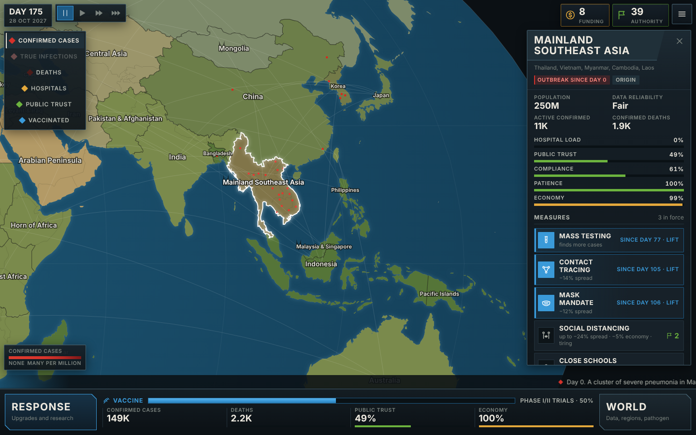

# Containment

A pandemic response strategy game in the spirit of *Plague Inc.* and *Rebel
Inc.*, played from the other side. A new pathogen has been confirmed in one
region of the world, and you run the global response: find it, slow it, treat
it and vaccinate against it before it outruns you. The pathogen adapts to
whatever you do.



Like [Frontline 1944](../frontline-1944/), the whole game is one
self-contained file, `index.html`. It needs no assets, no dependencies, no build
step and no network. The map is embedded vector data, everything is drawn on a
canvas, and the music and sound effects are synthesised at runtime.

## Play

Open `index.html` in any modern browser, on a laptop or a phone. Progress and
the current game are saved in the browser's local storage. Click or tap once to
enable sound.

## How it plays

- **You see confirmed cases, not real ones.** Each region reports only what its
  surveillance catches, so poor, crowded regions look clean long after they are
  burning. Detection upgrades narrow the gap. *Epidemic modelling* unlocks the
  true-infections map, and the end screen shows what was really there.
- **Funding** comes from donors (less when the economy or trust is weak) and
  from gold bubbles on the map. It pays for about 55 upgrades across five hex
  trees: Detect, Contain, Treat, Vaccine and Society. Prices rise as you buy, so
  you cannot have everything.
- **Authority** is political capital. You spend it to impose measures region by
  region: testing, contact tracing, masks, distancing, school closures,
  lockdowns, border, port and flight closures, field hospitals and vaccination
  drives. Measures cost economy and patience every day they stay in force. Tired
  publics comply less, and a region whose trust collapses defies you outright.
- **The vaccine** needs the genome (*Genome sequencing*) before research really
  starts. Research runs in wealthy regions' labs, so wrecking their economies
  slows it. Once approved, rollout is limited by factories, by each region's
  cold chain, by vaccine hesitancy, and by rich regions buying first unless you
  fund equitable allocation.
- **The pathogen fights back.** It earns evolution points from the number of
  people infected and spends them on traits that counter your strategy: silent
  carriage if you lean on testing, transmissibility if you lean on restrictions,
  immune escape once you vaccinate, drug resistance once you treat, an animal
  reservoir near the end. On Hardened it picks the counter almost every time.
- **Decisions** interrupt the game every month or so: mass gatherings,
  whistleblowers, protests, export bans, challenge trials and elections, each
  with a real trade-off.
- **You win** when there is not a single active infection left. **You lose** if
  the death toll passes what the world can absorb, if global trust falls to 14%,
  or if the pathogen is still circulating after four years.

## Pathogens and difficulty

Six pathogens, each played differently: Novel Coronavirus, Pandemic Influenza
(seasonal, drifts fast), Mosquito-borne Fever (tropical, needs vector control),
Superbug (treatment matters most, resistance evolves), Haemorrhagic Fever
(lethal, contact-traced) and Disease X (randomised, profile unknown). The first
two are open from the start; beating one unlocks the next.

**Recruit**, **Regular** and **Hardened** change funding, Authority, research
speed, how fast and how cleverly the pathogen evolves, how much has spread
silently before day one, how quickly publics lose patience, and how many deaths
the world can absorb. A win earns one to three stars depending on the death
toll.

## Look

The visual design follows Plague Inc and Rebel Inc. A natural, satellite-toned
world map (each region shaded by its climate, on a deep blue ocean) sits under
dark gunmetal chrome with steel hairline bezels, angled title tabs and bold
condensed capitals. Decisions arrive as paper dispatches. The palette is fixed:
four signal colours, each with exactly one meaning everywhere. **Red** is the
pathogen (cases, deaths, danger), **blue** is the response (research, vaccine,
your actions and selections), **green** is stability (trust, Authority, good
news) and **gold** is money (funding, economy, caution). The tokens live at the
top of the `<style>` block and in the `PAL` object in the UI script.

## Controls

| Action | Mouse / keyboard | Touch |
| --- | --- | --- |
| Pan / zoom | Drag, scroll wheel, `+` `-` | Drag, pinch |
| Open a region | Click it | Tap it |
| Collect a bubble | Click it | Tap it |
| Pause / speed | `Space`, `1` `2` `3` | Buttons, top left |
| Response / World | `R` / `W` | Buttons, bottom |
| Close a panel | `Esc` | ✕ |

## Code

`index.html` holds four blocks:

- `<style>` and the markup.
- `<script id="mapdata">`: 57 playable regions merged from Natural Earth
  1:50m countries (public domain), projected and simplified into SVG path
  strings, plus land borders and the stipple points for the infection overlay.
  Regenerate it with `tools/build-map.mjs`.
- `<script id="engine">`: the simulation. It has no DOM access: every input is a
  method call and `step()` advances exactly one day. Each region runs an SEIR
  model with vaccination and waning immunity, switching to stochastic dynamics
  at small numbers so the last chains of transmission really do die out. Air,
  sea and land travel seed new regions, and trust, fatigue, compliance, economy,
  healthcare capacity, research, vaccine allocation, events and the evolving
  adversary all sit on top. A seeded PRNG lives in the save, so games are
  reproducible.
- `<script id="ui">`: map rendering, input, panels, audio and saving.

`tools/simulate.mjs` extracts the engine from `index.html` and plays whole games
headless with scripted strategies (`idle`, `casual`, `expert`). It is how the
three difficulties were balanced:

```
node games/containment/tools/simulate.mjs 10 virus regular
```

An `idle` player must lose every pathogen on every difficulty. On Recruit a
`casual` player should usually win. On Hardened even the `expert` script
should lose a fair share of games.
