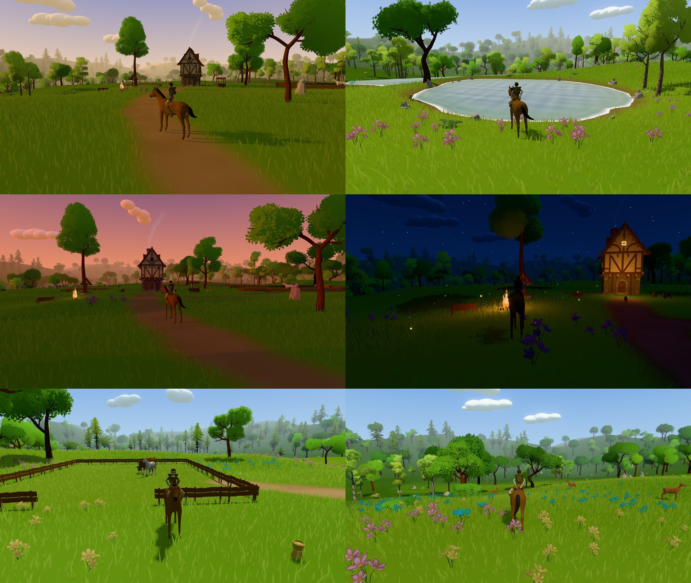

# Homestead

A shared countryside for two people to build a life in: ride out together,
raise a house, farm a plot, keep animals, and watch all of it grow and change
whether or not you are there.

**What exists today is the visual sample** — one rideable slice of the world,
built to agree the look before any of the systems are written.



## What the sample shows

- Rolling hills, a lane, a pond, woods, drifts of flowers, and grass that
  moves in the wind and parts round the horse's hooves.
- A cottage with a smoking chimney, a well, a fire, a paddock and the first
  tilled plot.
- A full day: dawn, midday, golden hour, sunset, and a night with stars, lit
  windows and fireflies. The clock runs on its own; you can also scrub it.
- You, on a horse, with a walk, a canter and a gallop.
- Animals with a little mind of their own. The cows and the grey mare graze
  the paddock. The deer bolt if you ride at them, sooner if you gallop. The
  dog comes to find you and keeps to your stirrup until you leave it behind.

## Run it

```
cd games/homestead
npm install
npm run dev            # http://localhost:5174
```

| Key | |
| --- | --- |
| `W` `A` `S` `D` | ride |
| `Shift` | gallop |
| `C` | switch between walk and canter |
| drag | look around |
| scroll | zoom |
| `P` | pause or run the clock |
| `H` | hide the interface |

```
npm run build          # normal build into dist/
npm run build:single   # one self-contained HTML file into dist-single/
npm run typecheck
```

The single-file build inlines every model and texture, so the look can be
shared as one file with no server behind it.

Homestead shares no code with Standoff and is not part of its build, its
tests or its Docker image.

## Layout

```
src/
  main.ts              boot and the frame loop
  assets.ts            loads models; turns material names into looks
  camera.ts  input.ts  ui.ts
  noise.ts             seeded noise — same seed, same countryside
  world/
    land.ts            the shape of the land as pure functions of (x, z)
    terrain.ts         samples land.ts onto the mesh you ride on
    grass.ts           instanced blades, streamed in tiles round the rider
    scatter.ts         woods, bushes, flowers, rocks, and instancing
    homestead.ts       cottage, yard, paddock, plot
    sky.ts             the clock, sun and moon, every light, the sky dome
    water.ts  fx.ts    pond; smoke, fire, fireflies
  entities/
    creature.ts        a skinned animal: gaits, turning, standing on a slope
    rider.ts           you and your horse
    animals.ts         what the other animals decide to do
tools/                 the asset pipeline (see ASSETS.md)
```

Three lines in this are drawn deliberately, because the full game needs them:

- **`land.ts` is pure.** It imports no renderer. A server can import the same
  file and agree with every client about where the ground is.
- **`Rider.intent()` and `Rider.step()` are separate.** One reads keys, the
  other moves a horse from an intent. A second rider is `step()` fed by
  intents from a socket.
- **`sky.ts` owns every light.** One number, the hour, decides the look.
  Weather and seasons are further inputs to that same resolve, and leaf
  colour is already a single tint per species waiting for them.

## Decided so far

- **Look:** smooth low-poly, soft shadows, moving grass, warm light, a full
  day and night.
- **Time passes while both players are offline.**
- **Models:** Quaternius, CC0. See [ASSETS.md](ASSETS.md).

## Not built yet

Everything that makes it a game rather than a place: a second player,
building, farming, cooking, keeping and breeding stock, pets you can call and
play with, weather, seasons, avatars, saving. The intended order is two
players riding together first, then building, then farming and cooking, then
animals and pets, then seasons and weather.

Known limits of the sample itself: pigs and hens are missing (the animal pack
used has neither with a walk cycle), the rider is posed in code rather than
animated, there is no sound, and the camera can pass through a tree crown.
